# Easy Node Dialog System - User Manual

## 1. Overview

Easy Node Dialog System is a node-based dialog tool for Unity. Visual editor for branching dialogs, saving player choices, localization, sprites, and runtime playback.

### Requirements

- **Unity 6** (6000.x). Developed on 6000.4.
- **TextMeshPro** (via Unity UI / `com.unity.ugui`). Default dialog UI uses TMP text fields.
- **Core runtime:** legacy `Input` API (`DialogLegacyInput` - Space / Enter / click). No Input System package required for the dialog stack itself.
- **RPG sample only:** Unity **Input System** package and the generated `Player Controls` asset in `Samples/RPG/Player/`.

### Quick start (samples)

Fastest way to see the system running - open a sample scene. Everything is already wired: Dialog Window prefab, Dialog Database, activators, initiators.

1. Open **`Samples/RPG/RPG Game Sample.unity`** or **`Samples/Visual Novel/Visual Novel Sample.unity`**.
2. Press **Play**.
3. **RPG:** move to an NPC, press the interaction key (see sample UI / `NpcDialogInteraction`). **VN:** select **DialogActivator** on the scene, click **Start dialog** in the Inspector.

To use dialogs in **your** game, copy that wiring (prefab + database on Runner + activators). Details: section 12 and sample checklists in sections 14-15.

### How this manual is organized

| Part | Sections | Topic |
|---|---|---|
| **I - Authoring** | [2](#2-opening-the-editor)–[11](#11-variables-tab) | Dialog Editor: databases, graph, nodes, names, sprites, variables |
| **II - Runtime** | [12](#12-runtime-architecture)–[13](#13-runtime-variables-and-save-file) | Scene setup, modules, `G` / save file |
| **III - Samples** | [14](#14-rpg-sample),[15](#15-visual-novel-sample) | RPG and Visual Novel scenes |
| **IV - Reference** | [16](#16-localization-csv-import--export)–[18](#18-assembly-definitions) | CSV, voice clips, asmdefs |
| **V - Deep dives** | [19](#19-editor-save-and-discard-behavior) | Optional editor mechanics (save/discard graph) |
| **Support** | [20](#20-support) | Contact |

**Where to start:**

- **Write dialogs** → Part I (start at section 2).
- **Play dialogs in a scene** → Part II (section 12), then samples in Part III if needed.
- **Replace the standard UI** → section 12 only.

---

## Part I - Authoring (Dialog Editor)

## 2. Opening the Editor

Open the editor through:

`Tools -> Easy Node Dialog System`

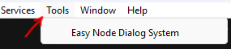

*Fig. 1: Open The Editor*

The editor has three main tabs:

- **Text:** dialogs, graph, categories, languages, character display names.
- **Character Sprites:** character sprite database.
- **Variables:** variable schema and runtime values.

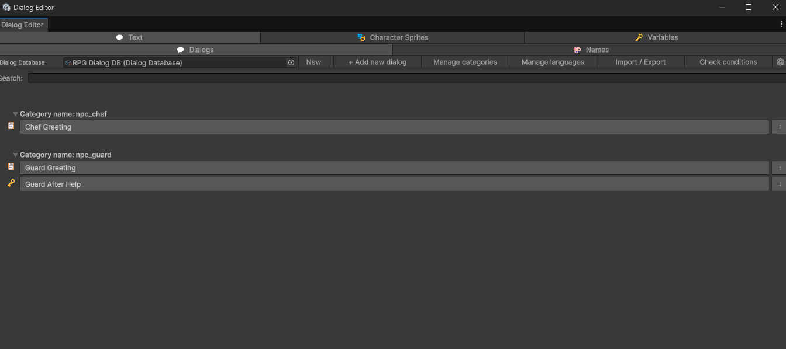

*Fig. 2: Main Dialog Editor Window*

---

## 3. Text Tab - Dialog List

The Text tab has two subtabs:

- **Dialogs:** create and edit dialog graphs.
- **Names:** manage character name colors and display name translations (section 9).

This section covers the **Dialogs** subtab: the database slot, the top toolbar (left to right), dialog rows, and the per-dialog context menu.

### Dialog list overview

The Dialogs subtab shows:

- **Top row:** Dialog Database slot, toolbar buttons, and (below) optional search.
- **Dialog rows:** one row per dialog - open graph, warning marker, context menu.

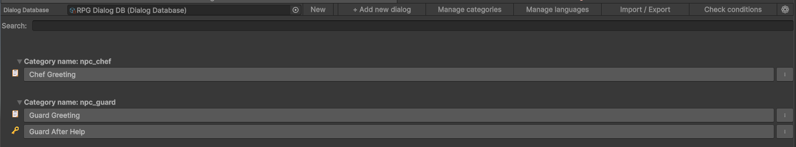

*Fig. 3: Dialog List*

The subsections below follow the top row **left to right**, then dialog rows and the context menu.

### Dialog Database slot

At the left of the top row:

- **Dialog Database object field:** select the database asset used by the editor.
- **New:** create a new Dialog Database asset.

While a dialog graph is open, the object field and **New** are disabled. A hint icon explains that you must use **Back to list** before switching databases.

All toolbar actions below apply to the assigned database.

### + Add new dialog

Creates a new dialog in the current database with a default **Start** node and opens it in the graph editor.

### Manage categories

Opens a popup to edit dialog initiators/categories.

- **Add:** adds a new category name.
- **x:** removes a category row.
- **Cancel:** closes the popup without applying.
- **Save:** applies the edited category list.

Category names are used by **DialogActivator** as initiators. Redirect nodes filter target dialogs by category.

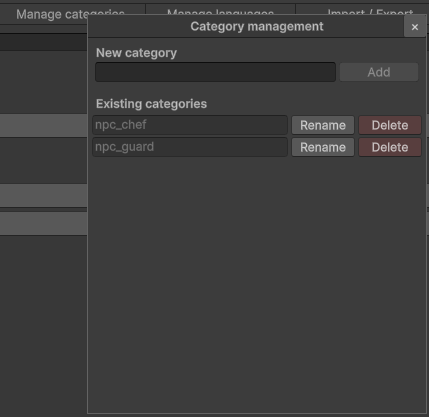

*Fig. 4: Manage Categories Popup*

### Manage languages

Opens a popup to define language codes for Line/Choice text and character display names.

- **Add:** adds a language code.
- **x:** removes a language row.
- **Cancel:** closes the popup without applying.
- **Save:** applies the edited language list.

When you **delete** a language from the list, Line, Choice, and name-color texts for that code are removed from the database.

#### Texts without language slot

If dialog or name-color texts use a language code that is **not** in **Existing languages**, the popup lists them at the bottom with entry counts.

- **Add:** adds the code to Available languages so the texts appear in the editor and runtime lookup.
- **Delete texts:** removes those text entries from dialogs and name colors. The language list is unchanged.

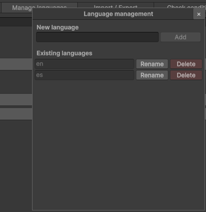

*Fig. 5: Manage Languages Popup*

### Import / Export

Opens the localization import/export popup (CSV).

- **Format:** file format dropdown (currently CSV).
- **Export:** saves a CSV for the assigned Dialog Database.
- **Import:** reads a CSV and writes texts back into matching keys.

CSV layout, Key format, and import rules are in section 16.

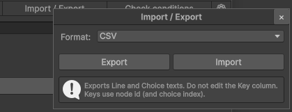

*Fig. 6: Import / Export Popup*

### Check conditions

Validates **all** dialog start conditions in the database and reports overlaps, multiple defaults per category, and ambiguous matches.

Shows the same kind of warning dialog as **Check conditions** on the graph toolbar (section 8, Fig. 20). No separate popup - results appear in an editor dialog.

### Settings (gear)

Opens editor settings for the current Dialog Database.

- **Include voice clips:** when enabled (default), each language foldout on a Line node shows a Voice row.
- When disabled, the editor asks for confirmation, clears all assigned voice clips in the database, and hides Voice UI.
- **Save logs in Console:** when enabled (default), writes formatted save/discard messages to the Unity Console. Field meanings and the full save matrix: section 19.

Line node authoring and runtime playback are in section 17.

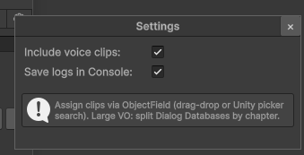

*Fig. 7: Settings Popup*

**Console log fields (short):**

| Field | Meaning |
|-------|---------|
| **Graph on disk: Current** | Asset graph matches the open graph in the editor. |
| **Graph on disk: Snapshot** | Other database data was saved, open graph node edits since last graph **Save** are still session-only. |
| **Graph session: Open** | A graph is open (Back / Save / Discard apply). |
| **Graph session: Closed** | Dialog list or no graph open. |

### Dialog rows

Each row in the list:

- **Dialog name button:** opens the graph editor for that dialog.
- **Warning marker:** appears when validation finds an issue.
- **Menu button:** opens context actions for that dialog.

### Dialog context menu

- **Duplicate:** duplicates the dialog and its nodes.
- **Move to/[category]:** changes dialog category/initiator.
- **Delete:** deletes the dialog and marks redirect references as missing.

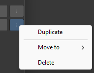

*Fig. 8: Dialog Context Menu*

---

## 4. Dialog Graph Toolbar

When a dialog is open, the graph toolbar appears above the canvas.

#### Buttons:

- **Back to list:** returns to the dialog list.
- **Show conditions:** opens/closes the start condition side panel.
- **Check integrity:** finds broken node links and offers fixes.
- **Check conditions:** validates start condition overlaps in the current category.
- **Go to start:** centers the canvas on the Start node.
- **Save:** saves all dialog editor session changes.
- **Auto-save interval popup:** controls editor auto-save interval.
- **+ Add line:** creates a Line node.
- **+ Add choice:** creates a Choice node.
- **+ Add condition:** creates a Condition node.
- **+ Add Redirect:** creates a Redirect node.
- **Initiator popup:** assigns the current dialog to a category/initiator.

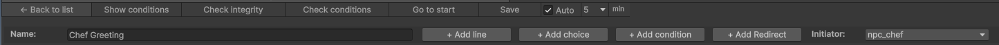

*Fig. 9: Graph Toolbar*

---

## 5. Graph Canvas Controls

#### Mouse controls:

- **Drag node header:** move a node.
- **Mouse wheel:** zoom in/out.
- **Pan canvas:** drag empty graph area with the configured editor panning behavior.
- **Click output port, then input port:** create a connection.
- **Right-click port:** open connection menu.
- **Right-click empty graph area:** open node creation menu.
- **Escape:** cancel a pending connection.

#### Port menus:

- **Disconnect:** removes an existing connection from that port.
- **Target node names:** connect to another node directly from the menu.

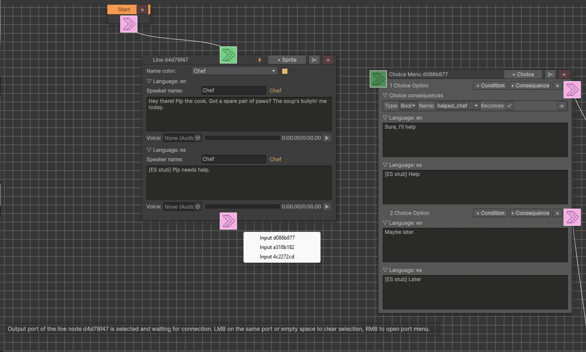

*Fig. 10: Graph Canvas and Ports*

### Context node creation menu:

- **Add Start Node:** creates a Start node if one does not already exist.
- **Add Line Node:** creates a Line node.
- **Add Choice Node:** creates a Choice node.
- **Add Condition Node:** creates a Condition node.
- **Add Redirect Node:** creates a Redirect node.

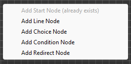

*Fig. 11: Right Click Node Creation Menu*

---

## 6. Node Types

### Start Node

The entry point of a dialog. A dialog should have one Start node.

#### Controls:

- **Output port:** connect to the first node in the dialog.
- **Delete button (x):** removes the node.
- **Duplicate button:** duplicates the node.

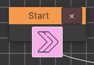

*Fig. 12: Start Node*

### Line Node

Displays dialog text and optional character sprite actions.

#### Toolbar controls:

- **x:** delete node.
- **Duplicate:** duplicate node.
- **Sprite/action button:** opens or focuses character action controls.
- **Instant toggle:** when enabled, the node applies sprite/text changes and advances without waiting for a click.

#### Content fields:

- **Character:** speaker name from the Names list.
- **Language foldouts:** text and optional speaker display name for each language.
- **Voice:** optional `AudioClip` per language (ObjectField, scrubber preview in the editor). Hidden when voice clips are disabled in Settings (section 3, Fig. 7). See section 17.
- **Character actions:** show/hide character sprites, set emotion, position, and zoom.

#### Character action buttons:

- **Preview (eye icon):** opens sprite preview.
- **Copy:** copies action parameters.
- **Paste:** pastes copied action parameters.
- **x:** removes the action.

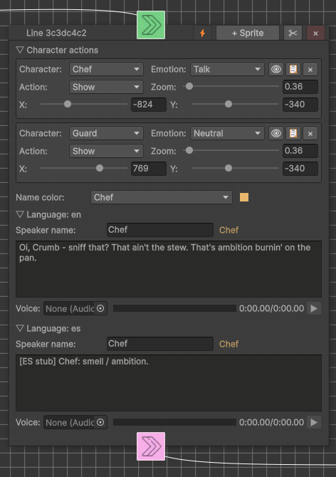

*Fig. 13: Line Node*

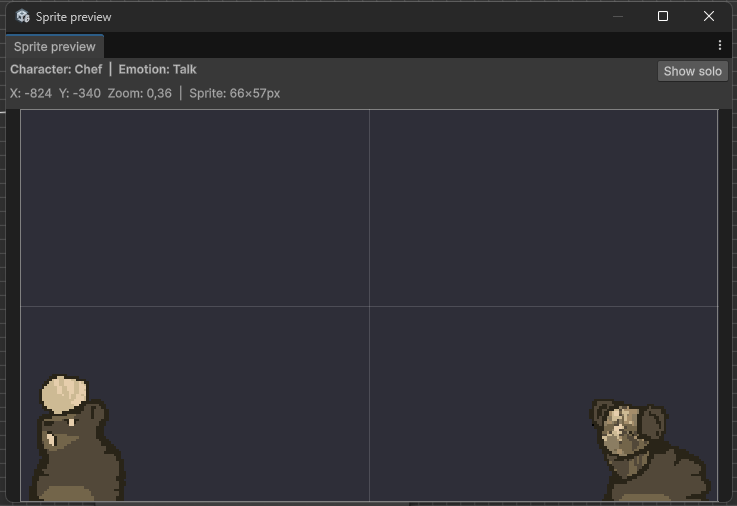

*Fig. 14: Sprite Preview Window*

### Choice Node

Shows selectable answers to the player.

#### Toolbar controls:

- **x:** delete node.
- **Duplicate:** duplicate node.
- **+ Choice:** adds a choice option.

#### Choice option controls:

- **x:** delete choice option.
- **+ Consequence:** add a variable change applied when the choice is selected.
- **+ Condition:** add a visibility condition for the choice.
- **&& / ||:** switch choice condition logic between AND and OR.

#### Choice fields:

- **Translations:** localized choice text.
- **Next node output:** connect each choice to the next dialog node.
- **Conditions:** variable checks that decide whether the choice is visible.
- **Consequences:** variable values applied after selecting the choice.

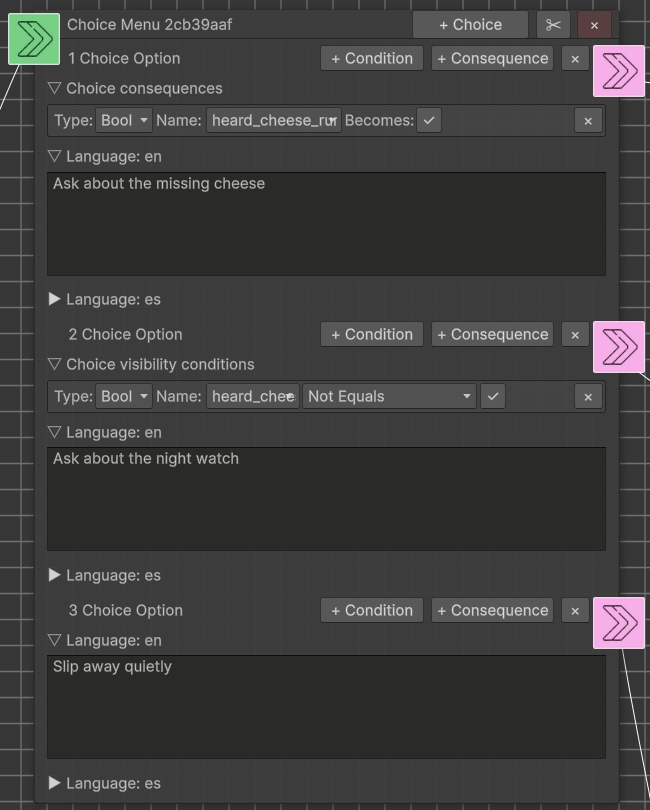

*Fig. 15: Choice Node*

### Condition Node

Branches the dialog based on variable conditions.

#### Toolbar controls:

- **x:** delete node.
- **Duplicate:** duplicate node.
- **+ Condition:** add a condition row.
- **&& / ||:** switch logic between AND and OR.

#### Ports:

- **Input port:** connect previous node.
- **True output:** used when conditions pass.
- **False output:** used when conditions fail.

#### Condition fields:

- **Variable type:** Bool, Int, Float, String.
- **Variable:** variable from the Dialog Database.
- **Operator:** Equals, NotEquals, GreaterThan, LessThan, GreaterThanOrEquals, LessThanOrEquals.
- **Value:** comparison value.

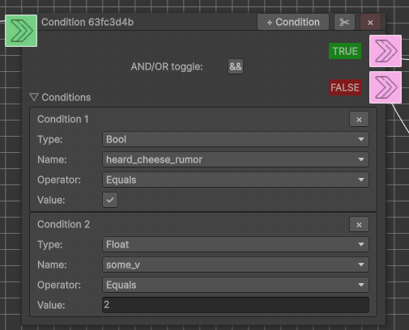

*Fig. 16: Condition Node*

### Redirect Node

Redirects playback to another dialog.

#### Controls:

- **Category:** target dialog category.
- **Dialog:** target dialog name.
- **Help box:** explains that only dialogs without start conditions can be selected.
- **x:** delete node.
- **Duplicate:** duplicate node.

#### Rules:

- Redirect targets can only be dialogs without start conditions.
- If a target dialog is deleted or moved, the editor marks the reference as missing.

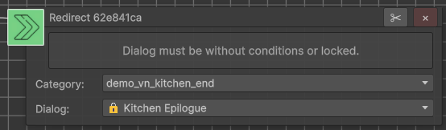

*Fig. 17: Redirect Node*

---

## 7. Start Conditions Panel

Open it with **Show conditions** in the graph toolbar.

This panel defines when a dialog is eligible for a category/initiator. At runtime, `TryStartDialogForInitiator` selects the first matching dialog in database order.

#### Controls:

- **Close arrow:** hides the conditions panel.
- **Help box:** explains how start conditions affect dialog selection.
- **Validation warning:** appears when overlapping start conditions are detected.
- **+ Add condition:** adds a start condition row.
- **&& / ||:** controls whether all conditions must pass or any condition may pass.

#### Condition row fields:

- **Variable type**
- **Variable name**
- **Operator**
- **Expected value**
- **Missing reference warning** if a variable was removed.

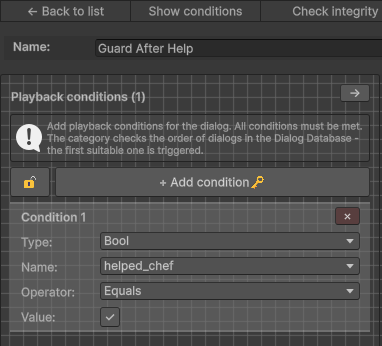

*Fig. 18: Start Conditions Panel*

---

## 8. Validation

### Check integrity

Use **Check integrity** in the graph toolbar.

It checks:

- Missing next node links.
- Choice outputs that point to deleted nodes.
- Condition true/false outputs that point to deleted nodes.
- Redirect target dialogs that were deleted, moved, or became invalid.

When possible, the validator offers a fix action.

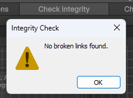

*Fig. 19: Check Integrity Result*

### Check conditions

Use **Check conditions** in the dialog list or graph toolbar.

It checks:

- Multiple dialogs in the same category that can match the same variable set.
- Multiple default dialogs in the same category.
- Dialogs whose start conditions overlap.

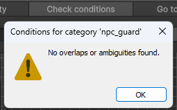

*Fig. 20: Check Conditions Warning*

---

## 9. Names Subtab

Open: `Text -> Names`.

This section controls speaker display names and text colors.

#### Controls:

- **Dialog Database slot:** select/create the Dialog Database.
- **+ Add name color:** add a new character name entry.
- **x:** delete a name color entry.
- **Name:** internal character/speaker key used by Line nodes.
- **Color:** speaker name color.
- **Name translations:** display name per language.
- **Preview:** shows the translated name in the selected color.

Deleting a name marks references as missing in dialogs instead of silently breaking them.

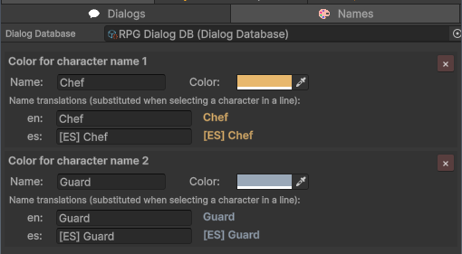

*Fig. 21: Names Subtab*

---

## 10. Character Sprites Tab

Open: `Character Sprites`.

This section edits character sprite groups stored in the Dialog Database and used by Line node character actions.

#### Controls:

- **Dialog Database slot:** select/create the Dialog Database that stores character sprites.
- **Search/filter field:** filter visible characters.
- **+ Add sprite:** add a sprite/emotion entry to a character.
- **Character rename button:** rename a character and update dialog references.
- **Sprite rename button:** rename an emotion and update dialog references.
- **Delete:** remove a sprite entry.
- **Missing reference help:** tells where a sprite/character is still used or was removed.

#### Data model:

- **Character:** named group.
- **Sprite/emotion:** named sprite inside a character group.

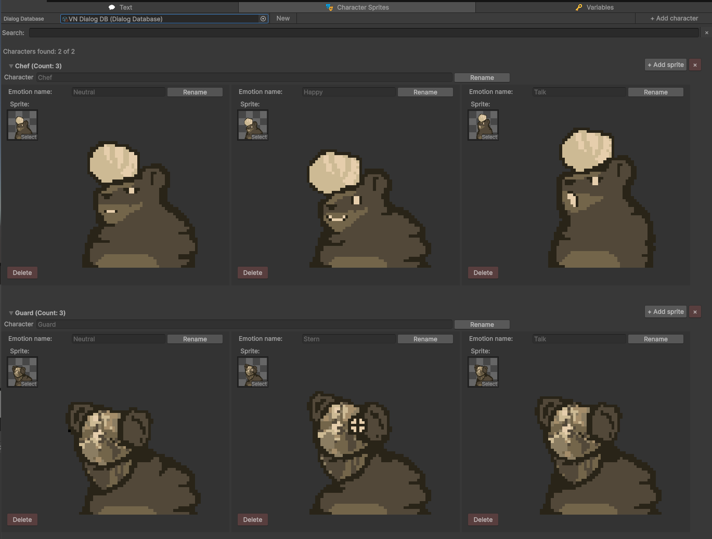

*Fig. 22: Character Sprites Tab*

#### Runtime usage:

Line node **Character actions** (Show/Hide) → **DialogCharacterPortraitPresenter** (section 12).

---

## 11. Variables Tab

Open: `Variables`.

The variable system has two layers:

- **Template:** variable schema in the Dialog Database (name, type, default value).
- **Current:** runtime values in `G`.

#### Top controls:

- **Dialog Database slot:** select/create the Dialog Database that stores variables.
- **Load Current from save.json:** load runtime values from the save file.
- **Save Current to save.json:** write runtime values to disk.
- **Open save.json:** open the save file location/file.

#### Create variable controls:

- **Variable name:** new variable key.
- **Variable type:** Bool, Int, Float, String.
- **Default value:** default value stored in the SO.
- **+ Create variable:** add it to the database and initialize runtime value in `G`.

#### Variable list controls:

- **Template / Save:** edit and save the variable name, type, and default value in the SO.
- **Current / Save:** edit and save current runtime value in `G`.
- **x:** delete a variable and mark references as missing.

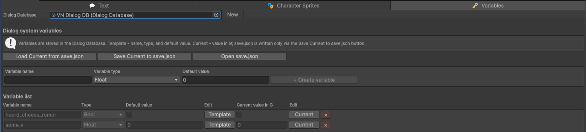

*Fig. 23: Variables Tab*

---

## Part II - Runtime (scene + API)

## 12. Runtime Architecture

**DialogRunner** owns the dialog session (graph, conditions, variables). Everything else is a replaceable peripheral. It listens to Runner events and calls Runner commands. Peripherals do not reference each other. Runner never references View, Input, Audio, or Save.

Drop in **`Core/Dialog Window/Dialog Window.prefab`** for the default stack (Runner + View + Save + Input + Audio). Add **DialogCharacterPortraitPresenter** for VN sprites. **DialogActivator**, **DialogPreferences**, and **DialogDebugger** - per scene or NPC as needed.

Public API lives in `#region Developer API` on each script. Implementation details (subscriptions, animations) stay in code. You only need them when replacing a module.

### Module map

| Module | Required | Talks to Runner via | Replace when |
|---|---|---|---|
| **DialogRunner** | yes | - (session core) | custom dialog engine (rare) |
| **DialogWindow** | default View | events in + `Notify*` out | your own UI |
| **DialogCharacterPortraitPresenter** | no | `LineReady`, `DialogEnded`, `DialogCancelled` | custom portrait layer |
| **DialogLegacyInput** | default input | `Advance()` | Input System / UI-only |
| **DialogAudioPlayer** | default audio | `LineReady`, `LineSkipRequested`, session end | custom audio pipeline |
| **DialogSave** | recommended | `DialogEnded` (optional auto-save), bootstraps `G` | your save system |
| **DialogDebugger** | no | `DiagnosticReported` | your logging |
| **DialogActivator** | scene helper | `TryStartDialogForInitiator` | your start trigger |
| **DialogPreferences** | no | language for DB lookup | your locale system |

**Prefab widgets (View only):** **DialogChoiceButtonUI** on the choice button prefab, **DialogCharacterPortraitSlotUI** on the portrait slot prefab. Edit prefab visuals there, no Runner coupling.

### DialogRunner

**In:** `DialogDatabase`, `StartDialog` / `TryStartDialogForInitiator`, `Advance`, `SelectChoice`, `CancelDialog`.

**Out:** presentation events (`LineReady`, `ChoicesReady`, …), session events (`DialogStarted`, `DialogEnded`, `DialogCancelled`), `GameplayFreezeRequested`, optional `DiagnosticReported`.

**View handshake** (only if you replace **DialogWindow**):

| Runner → View | View → Runner |
|---|---|
| `DialogStarted` | after open: `NotifySessionOpened` |
| `LineReady` (non-instant) | after line shown: `NotifyLinePresentationReady` |
| `LineSkipRequested` | after skip reveal: `NotifyLinePresentationReady` |
| `ChoicesReady` | on pick: `SelectChoice(index)` - **index** from this event list |
| `DialogEnded` / `DialogCancelled` | after close: `NotifySessionClosed` |

Instant lines: Runner advances without waiting for `NotifyLinePresentationReady`. `CancelDialog` fires `DialogCancelled`. View must close the panel and call `NotifySessionClosed` (Runner does not hide UI).

Gameplay freeze is not automatic: subscribe to `GameplayFreezeRequested` in your game code (RPG sample: **DialogRunnerToGameplayBridge**).

### Customizing the default UI

| Goal | Where to work |
|---|---|
| Restyle text bar, fade, choice layout | **Dialog Window** prefab + **DialogChoiceButtonUI** prefab |
| VN standing sprites | **DialogCharacterPortraitPresenter** + **DialogCharacterPortraitSlotUI** prefab |
| Different continue / choose input | **DialogLegacyInput** or your Input System / UI buttons → `Advance` / `SelectChoice` |
| Voice routing / mixer | **DialogAudioPlayer** or your audio module on Runner events |
| Replace UI entirely | Your View component + handshake table below, **DialogRunner** unchanged |

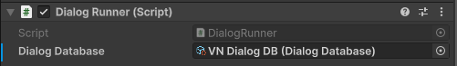

*Fig. 24: DialogRunner Inspector*

### DialogWindow (default View)

**In:** Runner events above. Wire text bar, choices, optional diagnostic line, choice button prefab (**DialogChoiceButtonUI**).

**Out:** `NotifySessionOpened`, `NotifyLinePresentationReady`, `NotifySessionClosed`, `SelectChoice`.

**Extra API:** `ShowTextBarMessage` (idle HUD on the bar), `ShowDiagnosticLineDuringDialog` (needs **Diagnostic Line Text** assigned).

Does not start dialogs. Does not render character sprites (use **DialogCharacterPortraitPresenter**).

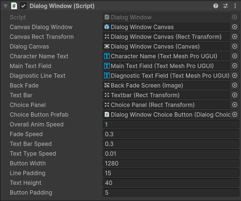

*Fig. 25: DialogWindow Inspector*

### DialogCharacterPortraitPresenter (optional)

**In:** `LineReady.CharacterActions`, session end/cancel.

**Out:** portrait slots under **Characters Container** (show/hide/clear). Wire slot prefab with **DialogCharacterPortraitSlotUI**. Missing sprites: warning, dialog continues.

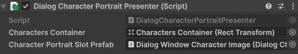

*Fig. 26: DialogCharacterPortraitPresenter Inspector*

Other runtime modules (**DialogSave**, **DialogLegacyInput**, **DialogAudioPlayer**, **DialogDebugger**, **DialogActivator**, **DialogPreferences**): see module map above, Inspector fields in Fig. 27-32.

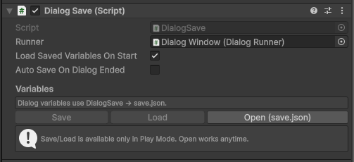

*Fig. 27: DialogSave Inspector*

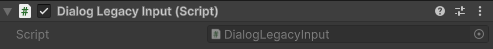

*Fig. 28: DialogLegacyInput Inspector*

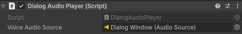

*Fig. 29: DialogAudioPlayer Inspector*

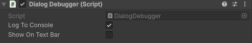

*Fig. 30: DialogDebugger Inspector*

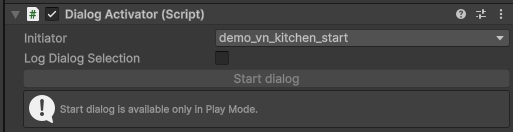

*Fig. 31: DialogActivator Inspector*

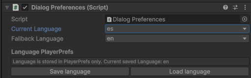

*Fig. 32: DialogPreferences Inspector*

### Replacing the default UI

1. Keep **DialogRunner** (+ usually **DialogSave**). Assign **Dialog Database**.
2. Remove or disable **DialogWindow**, **DialogLegacyInput**, **DialogAudioPlayer**, **DialogCharacterPortraitPresenter** as needed.
3. Implement the View handshake table above on your component(s). Full event list and payloads: `#region Developer API` on **DialogRunner** and **DialogPresentations.cs**.

Or keep **DialogWindow** and only restyle its prefab / swap **DialogChoiceButtonUI** and portrait prefabs - no Runner changes.

---

## 13. Runtime Variables and Save File

### One story: runtime vs persistence

| Layer | Use for |
|-------|---------|
| **`G` (static)** | Read/write dialog variables during gameplay (`SetBool`, `GetInt`, …). Used by `DialogRunner` for conditions and choice consequences. |
| **`DialogSave` (component)** | Bootstrap `G` from the Dialog Database schema, load/save `save.json` in builds, optional auto-save on `DialogEnded`. |
| **`G.SaveGame()` / `G.LoadGame()` (advanced)** | Editor tools (Variables tab, custom inspector), tests, or your own tooling. In shipped games prefer **`DialogSave.Load()` / `DialogSave.Save()`** so persistence stays in one place. |

Typical Play Mode flow with **DialogSave** on the scene:

1. `InitializeVariables()` - defaults from Dialog Database.
2. `Load()` - overlay values from `save.json` for variables **still defined in the database**.
3. Dialog runs, `G` changes in memory.
4. `DialogEnded` (optional auto-save) or manual `Save()` - write `save.json`.

#### Supported types

- Bool
- Int
- Float
- String

#### Runtime API (in-game logic)

```csharp
G.SetBool("quest_started", true);
bool started = G.GetBool("quest_started");
G.SetInt("gold", 10);
```

Empty variable name on `Get*` / `Set*` throws `ArgumentException` (programmer error). Unknown variable name on `Get*` returns the type default (`false`, `0`, `""`) - usual for conditions when the name is valid in the graph but not initialized yet.

#### Persistence API (save file)

```csharp
// Preferred in builds (DialogSave on scene):
dialogSave.Load();
dialogSave.Save();

// Advanced / editor / tests:
G.LoadGame();
G.SaveGame();
```

#### Default save path

```text
Application.persistentDataPath/save.json
```

Play Mode and editor:

- **DialogSave** inspector: **Save**, **Load**, **Open (save.json)**.
- **Variables** tab: **Save Current to save.json**, **Load Current from save.json**, **Open save.json** (calls `G` directly).

#### Save file format and game updates

Each save includes **`saveVersion`** (currently `1`). Older files without the field are treated as version 1.

**Load applies only variables that exist in the current Dialog Database schema** (after `InitializeVariables`). Example: you removed `old_quest_flag` from the database but an old `save.json` still lists it. That entry is **ignored**, not loaded into `G`, and will **not** come back on the next save. Renamed variables in the editor are a **new** name in the schema. The old key in the file is ignored unless you migrate saves yourself.

Writes use a **temp file + replace** so a crash mid-save is less likely to corrupt the main `save.json`.

**Not included (by design):** multiple save slots, cloud sync, or full game-state serialization. Use your own save system. Keep `DialogSave` only for dialog `G` variables, or replace it entirely.

**Trade-off:** one global `G` and one default file path keep the package small. Multiple profiles or parallel test domains need custom file paths (`Load(path)` / `Save(path)`) or a replacement save module.

---

## Part III - Samples

## 14. RPG Sample

Player movement, NPC proximity, interaction key, dialog by initiator. Runtime modules: section 12.

**Sample-only scripts:** `NPC`, `NpcInteractionTriggerRelay`, `NpcDialogInteraction`, `DialogRunnerToGameplayBridge`, `Player Controller` / `Player State` / `Player Controls`.

**Scene checklist:** Dialog Window prefab + Dialog Database on Runner + **DialogActivator** on NPCs + **NpcDialogInteraction** on scene + **DialogRunnerToGameplayBridge** on player. Optional: **DialogPreferences**, **DialogDebugger** (wire **Diagnostic Line Text** on DialogWindow), voice on **DialogAudioPlayer**.

---

## 15. Visual Novel Sample

No NPC scripts. Dialog Window prefab + **DialogCharacterPortraitPresenter** (section 12, Fig. 26) + **DialogActivator** with initiator. Optional voice on **DialogAudioPlayer**.

**Start dialog:** Play Mode button on **DialogActivator**, or `TryStartDialog()`. Exact dialog by name: `StartDialog(entry)` from `DialogRunner.DialogDatabase.Dialogs`. Category pick: `TryStartDialogForInitiator`. Skip **DialogRunnerToGameplayBridge** unless you need gameplay freeze.

---

## Part IV - Reference

## 16. Localization CSV Import / Export

Open from the Dialogs list toolbar: **Import / Export** (section 3, Fig. 6).

Use this to send Line and Choice texts to translators and re-import translations into the Dialog Database.

#### Popup controls:

- **Format:** file format dropdown (currently CSV).
- **Export:** saves a CSV for the assigned Dialog Database.
- **Import:** reads a CSV and writes texts back into matching keys.

#### What is exported:

- Line node texts (per language).
- Choice option texts (per language).
- Not exported: speaker names, voice clips, sprite actions, conditions, consequences.

#### CSV layout:

- First column: **Key**
- Next columns: one column per language code from Manage languages (for example `en`, `ru`)

#### Key format (do not edit Key values):

- Line text: `{nodeId}.line`
- Choice text: `{nodeId}.choice.{index}` (`index` starts at 0)

Example:

```text
Key,en,ru
a1b2c3d4-....line,Hello!,Привет!
a1b2c3d4-....choice.0,Yes,Да
a1b2c3d4-....choice.1,No,Нет
```

#### Import rules:

- Matching keys update existing Line/Choice texts.
- Unknown or malformed keys are reported and skipped.
- Voice clips and other non-text fields are unchanged.
- If the CSV contains language columns that are **not** in Manage languages, the editor asks before import:
  - **Add:** adds those language codes to Available languages, then imports.
  - **Import only:** imports texts without adding the codes. Texts stay in the asset but remain hidden in the editor until you add the language (Manage languages **Add** on an orphan row, or add the code manually).
  - **Cancel:** aborts import.

#### Notes:

- Keep the Key column intact.
- Export includes columns from Manage languages only. Orphan texts (language codes in nodes but not in the list) are not exported until you add the language.
- Graph Save does not remove texts for languages outside Available languages. Use **Delete language** or **Delete texts** in Manage languages to clean them up.
- After import, save the Dialog Database if the editor does not auto-save.

---

## 17. Line Voice Clips

Line nodes can store one optional voice `AudioClip` per language.

### Enable / disable

In the Dialogs list toolbar, open **Settings (gear)** (section 3, Fig. 7):

- **Include voice clips:** when enabled (default), each open language foldout on a Line node shows a Voice row.
- When disabled, the editor asks for confirmation, clears all assigned voice clips in the database, and hides Voice UI.

### Authoring in a Line node

Inside each language foldout:

- **ObjectField:** drag-drop an AudioClip or pick one with the Unity object picker (wav, mp3, ogg, aiff, and other formats Unity imports as AudioClip).
- **Scrubber + time:** preview position (`current/total`). Dragging while preview is playing pauses playback and resumes on mouse up from the new position. Dragging while stopped only moves the playhead.
- **Play / Pause:** editor preview only (does not use DialogWindow).

### Runtime playback

1. Add **DialogAudioPlayer** to the scene (included on the Dialog Window prefab).
2. Add an **AudioSource** on the same object or a child.
3. Assign the AudioSource to **Voice Audio Source** on DialogAudioPlayer.
4. At runtime, DialogAudioPlayer plays `LineReady.VoiceClip` for the current language and stops on choices, dialog end/cancel, or line skip.
5. Instant Line nodes do not play voice.

#### Notes:

- Clips are Unity asset references on the Dialog Database, not embedded audio bytes.
- Large VO libraries: prefer splitting Dialog Databases by chapter so one asset does not pull every clip at once.
- CSV localization does not include voice clip paths. Assign clips in the editor.
- Editor preview volume cannot be controlled through Unity's internal AudioUtil path. Runtime volume uses the AudioSource (and optional Audio Mixer Group on that source).

---

## 18. Assembly Definitions

The package is split into assembly definitions:

- `ALTUSHKA.EasyNodeDialogSystem.Data`: ScriptableObject data classes.
- `ALTUSHKA.EasyNodeDialogSystem.Core`: runtime dialog system, dialog window, activator, preferences, variables.
- `ALTUSHKA.EasyNodeDialogSystem.Editor.CustomInspectors`: custom inspectors.
- `ALTUSHKA.EasyNodeDialogSystem.Editor.DialogEditorWindow`: dialog editor window and validation helpers.
- `ALTUSHKA.EasyNodeDialogSystem.Samples`: RPG sample scripts.

#### Notes:

- Asset files (.asset, .prefab, .unity) do not belong to asmdef files.
- Editor asmdefs must be Editor-only.
- Runtime namespaces can stay ALTUSHKA.EasyNodeDialogSystem even when code is split into several asmdefs.

---

## Part V - Deep dives (optional)

## 19. Editor save and discard behavior

Toggle **Save logs in Console** in **Settings (gear)** (section 3, Fig. 7). When enabled, the editor writes a short message to the Unity Console after each Save or Discard.

#### Saved (examples)

```
[Dialog Editor] Saved

Asset: MyDialogDatabase
Trigger: Add variable
Graph on disk: Current
Graph session: Closed
```

```
[Dialog Editor] Saved

Asset: MyDialogDatabase
Trigger: Toolbar Save button
Graph on disk: Current
Graph session: Open
```

```
[Dialog Editor] Saved

Asset: MyDialogDatabase
Trigger: Add variable
Graph on disk: Snapshot
Graph session: Open
```

| Field | Meaning |
|-------|---------|
| **Asset** | Dialog Database asset that was written. |
| **Trigger** | Editor action that caused the save (for example `Add variable`, `Toolbar Save button`, `Delete language`). |
| **Graph on disk** | **Current** - asset graph matches the open graph. **Snapshot** - other data saved, node edits since last graph **Save** stay session-only until graph Save or Discard. |
| **Graph session** | **Open** - a graph is open (including when you switch to Variables, Sprites, or Names). **Closed** - dialog list or no graph open. |

#### Discarded unsaved graph edits

```
[Dialog Editor] Discarded unsaved graph edits

Asset: MyDialogDatabase
Graph rollback: Chapter1_Intro
Graph session: Open
```

| Field | Meaning |
|-------|---------|
| **Asset** | Dialog Database asset affected by the rollback. |
| **Graph rollback** | Which dialog had node edits since the last graph Save reverted. |
| **Graph session** | Usually **Open** until Back to list. |

#### Save behavior (full matrix)

| Action | What is written |
|--------|-----------------|
| Variables, sprites, or name colors edit | Those changes are written to the asset. The dialog graph in the file is unchanged if the open graph has edits since the last graph Save. |
| Rename/delete variable, sprite, or name with dialog reference updates | Registry change plus matching reference patches in dialogs are written immediately (including to the graph session baseline). Unsaved node layout edits stay session-only until graph Save or Discard. |
| Graph Save, Auto-save, Back with Save | Open dialog graph and the rest of the database. Does not remove texts for languages outside Available languages. |
| Add, rename, or delete category | Categories and affected dialog assignments. |
| Add, rename, or delete language in Manage languages | Languages list. **Delete language** also removes Line, Choice, and name-color texts for that code. Graph Save does not strip orphan language texts. |
| Voice clips enabled or disabled in settings | Database settings (and clip data when disabled). |
| Add, duplicate, delete, or move dialog in the list | Dialog list and affected graphs. |
| Editor close with open graph | Node edits since the last graph Save are written to the asset. |
| Dialog Database asset switch | Blocked while a graph is open. Otherwise the previous database is saved before loading the new one. |

---

## 20. Support

For support, contact:

`altushka.dev@outlook.com`

**Version:** 1.0.0